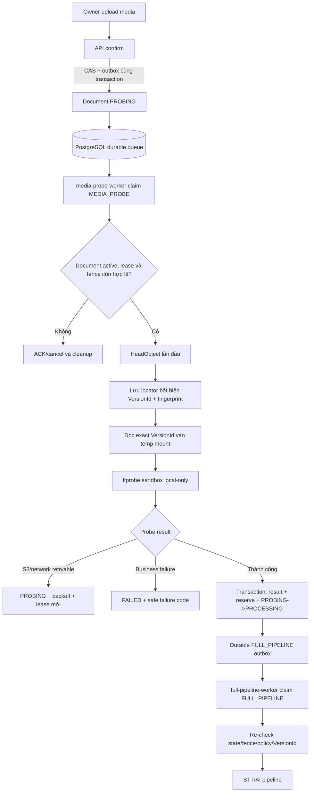
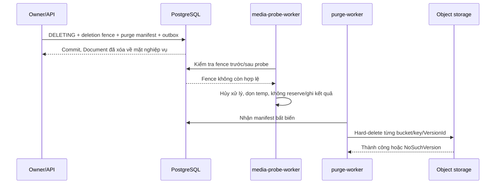

# ADR-0031: Media probe tách khỏi full-pipeline worker

## Trạng thái

Đã chốt trong GitHub Issue #158. Đây là contract kiến trúc và vận hành cho
MVP-2; tài liệu không tự xác nhận rằng workload, image hoặc hạ tầng đã được
triển khai thành công.

## Bối cảnh

MVP-2 nhận thêm MP3 và MP4 do Owner upload. Trước khi chạy STT hoặc bước AI,
hệ thống phải đọc metadata media để biết file có dùng được hay không. Bytes
này là dữ liệu không tin cậy: parser media có thể gặp file malformed, metadata
sai hoặc input cố tình gây tốn CPU, RAM và ổ đĩa.

Nếu chạy `ffprobe` trong cùng Pod (đơn vị chạy container) với full-pipeline
worker, một lỗi trong parser sẽ nằm cùng trust boundary (ranh giới quyền và
mức độ tin cậy) với AI credential, quyền đọc dữ liệu và quyền gọi provider.
`-protocol_whitelist` chỉ hạn chế protocol mà `ffprobe` được phép mở; nó không
phải sandbox chống RCE (thực thi mã ngoài ý muốn).

Hệ thống hiện đã có PostgreSQL durable queue (hàng đợi bền) và relay hiện hữu.
Không thêm queue, broker hay user-facing service mới. Local dùng MinIO trong
Docker Compose. Dev, stg và prod chạy trên VPS ngoài AWS; S3 chỉ được gọi qua
egress proxy (cổng đi ra có allowlist), không dùng VPC hoặc giả định có đường
PrivateLink tới S3.

## Quyết định

### 1. Tách workload và quyền

Có hai workload dùng chung codebase Go và durable queue, nhưng khác image,
Deployment, ServiceAccount (danh tính workload) và credential:

| Workload | Chỉ nhận | Quyền chính | Quyền bị cấm |
| --- | --- | --- | --- |
| `media-probe-worker` | `MEDIA_PROBE` | Đọc `HeadObject` và đúng object version ở media bucket; cập nhật probe state, lease, source locator, credit transition và outbox qua repository operation được allowlist | AI provider, document bucket, playback credential, `DeleteObjectVersion`, `FULL_PIPELINE`, executable không cần cho probe |
| `full-pipeline-worker` | `FULL_PIPELINE` | Đọc đúng `bucket + key + VersionId` đã được probe; gọi STT/AI theo pipeline hiện hữu; ghi kết quả theo return seam | `MEDIA_PROBE`, đọc latest object theo key, bỏ qua deletion fence hoặc locator đã lưu |

Ranh giới này phải được kiểm tra ở cả câu SQL và runtime worker:

- Câu lệnh claim bắt buộc lọc đúng `job_type` của workload và expected state.
  Repository chỉ expose operation đã allowlist cho workload đó; hai negative
  test phải chứng minh probe không claim `FULL_PIPELINE` và full-pipeline không
  claim `MEDIA_PROBE`.
- Database role của probe và full-pipeline là credential riêng, chỉ được cấp
  quyền bảng/cột cần thiết cho operation tương ứng, không phải DB owner. Role
  không tự biến thành policy theo từng row: vì MVP không dùng SQL function,
  procedure hoặc RLS, điều kiện `job_type` trong query, repository boundary và
  lease/fence là các lớp kiểm soát phải giữ đồng thời.
- Mọi mutation yêu cầu lease token, `probeGeneration` hoặc attempt tương ứng,
  deletion fence và expected state. Không dựa riêng vào `if/else` trong Go để
  chặn job sai loại.
- Dùng database role/credential riêng cho probe với quyền tối thiểu. Quyền
  ghi `FULL_PIPELINE` outbox chỉ phục vụ completion đã kiểm tra; consumer
  `FULL_PIPELINE` vẫn phải kiểm lại `PROCESSING`, policy version, deletion
  fence và source locator trước khi chạy AI.
- Không dùng SQL function, procedure, trigger hoặc RLS cho contract này.
  Repository dùng các câu SQL tham số hóa, ngắn và đọc được; quyền giới hạn
  nằm ở database role và query allowlist.

`media-probe-worker` không gọi `ffprobe` trong API process và không chạy trong
image/deployment của full-pipeline worker. Image probe không mang AI SDK, AI
credential bootstrap hoặc executable full-pipeline không cần thiết.

### 2. Queue, claim và tính lặp lại an toàn

`MEDIA_PROBE` dùng `ai.processing_jobs` và outbox hiện có theo ADR-0023; queue
có ngữ nghĩa at-least-once (có thể giao lại). `confirm` chỉ làm hai việc trong
một transaction của schema sở hữu: CAS `UPLOADED -> PROBING` và ghi durable
`DocumentProbeRequested`. Request này không chờ worker và API trả
`202 Accepted` cùng trạng thái `PROBING`.

Mỗi probe request giữ bất biến:

```text
idempotency key = documentId + probeGeneration + policyVersion
```

`VersionId` chưa chắc tồn tại ở lúc `confirm`, nên không đưa nó vào key của
request ban đầu. Ở lần claim đầu tiên, worker thắng lease thực hiện
`HeadObject`, kiểm tra object còn thuộc Document, rồi persist locator bất biến:

```text
bucket, key, VersionId, ETag, ContentLength, policyVersion
```

Worker chỉ đọc `VersionId` đã persist ở mọi retry sau đó; không đọc lại
"latest version" theo key. Fingerprint được tính từ object version đã đọc và
được lưu cùng probe result. Nếu object bị thay thế hoặc fingerprint không
khớp, probe fail-closed.

Completion thành công phải là một transaction có thể kiểm tra và lặp lại an
toàn: persist fingerprint, duration và policy result; reserve credit; chuyển
`PROBING -> PROCESSING`; ghi đúng một `FULL_PIPELINE` outbox. Unique constraint
và idempotency key ngăn delivery lặp tạo thêm credit hoặc job. Không có trạng
thái reserve thành công nhưng outbox bị mất.

Nếu reserve thất bại bằng `BudgetExhaustedError`, completion vẫn phải commit
probe receipt và locator bất biến, chuyển Document sang `FAILED` với
`BUDGET_EXHAUSTED`/`EXHAUSTED`, và acknowledge completion mà không reserve hoặc
tạo `FULL_PIPELINE`. Chỉ bắt lỗi budget cụ thể; lỗi database, authorization và
fence vẫn phải rollback/fail. Sau khi Owner nạp thêm credit, retry tạo
`probeGeneration` mới trên cùng VersionId đã lưu; completion mới reserve một
lần rồi tạo một pipeline request.

Retryable S3/network failure giữ Document ở `PROBING`, có attempt cap, lease
expiry và backoff. Business failure (file hỏng, codec không hỗ trợ, vượt
giới hạn, metadata không đọc được, protocol ngoài allowlist) chuyển sang
`FAILED` và không retry tự động. Hết retry cũng chuyển sang `FAILED` với mã
lỗi an toàn; chỉ lỗi được đánh dấu retryable mới cho phép Owner yêu cầu probe
lại bằng generation mới. `policyVersion` của request cũ không âm thầm đổi khi
retry; áp policy mới phải tạo generation/revalidation mới.

### 3. Xóa Document và purge version

Xóa Document không chờ lease hiện tại kết thúc vì worker có thể treo hoặc cứ
gia hạn lease. Transaction xóa phải:

1. Đánh dấu Document `DELETING` hoặc đã xóa và tăng deletion fence.
2. Vô hiệu hóa lease hiện tại.
3. Ghi purge manifest bất biến và durable `DocumentPurgeRequested`.

Ngay sau khi transaction commit, mọi worker phải fail fence: không renew lease,
không reserve credit, không ghi kết quả và không enqueue bước mới. Nếu worker
đã mở stream trước thời điểm xóa, bytes đã nằm trong RAM hoặc file tạm không
thể thu hồi tuyệt đối; cancellation phải dừng sớm, dọn file tạm và fence
không cho commit kết quả.

Trước khi tạo manifest, deletion coordinator lấy advisory lock chung với enqueue
và persist locator đầu tiên, rồi khóa mọi row `ai.media_probe_jobs` của đúng
Document/Owner. Manifest union locator hiện tại, preflight hợp lệ khi chưa có
locator persisted, các probe job và receipt; chỉ nhận đúng media bucket cùng
storage key bất biến và dedupe theo VersionId. Worker persist locator phải lấy
cùng advisory lock, rồi kiểm lại Owner, generation, policy, fence, lease và
trạng thái `RUNNING`; lock query phải tôn trọng cancellation context.

Purge worker dùng `bucket + key + VersionId` trong purge manifest để hard-delete
từng version cụ thể. `NoSuchVersion` là thành công; lỗi S3 tạm thời retry có
backoff và giới hạn; lỗi quyền hoặc cấu hình vào dead-letter và alert, không
retry vô hạn. Manifest/tombstone giữ metadata tối thiểu để retry/audit và vẫn
tồn tại sau khi Document row bị xóa.

Orphan scanner sau 24 giờ chỉ là safety net (lưới an toàn), không thay purge
chính. Scanner chỉ quét namespace/tag do hệ thống quản lý, chỉ xóa version
không còn reference trong DB hoặc purge manifest, không có job/lease hợp lệ và
đã đủ tuổi; phải có phân trang, rate limit và metric. Lifecycle không được xóa
non-current version đang còn được Document active tham chiếu.

### 4. `ffprobe` và sandbox

`media-probe-worker` có image riêng chứa exact `ffprobe` artifact. CI phải kiểm
image digest, package/artifact checksum, exact `ffprobe -version` và build
configuration; SBOM (danh mục thành phần phần mềm) và supply-chain scan là
kiểm tra bổ sung. Readiness fail-closed nếu binary thiếu hoặc sai. Startup
check không thay thế kiểm tra nguồn cung image.

Artifact được pin tới BtbN release/tag bất biến
`autobuild-2026-10-09-14-16`, asset
`ffmpeg-n8.1.3-16-ge0a878dd70-linux64-gpl-8.1.tar.xz`, SHA-256
`968255015cc65dd999a7eddf8016be89a8a1bbef063ea7d3e9c3a229b0f6faaf`.
Release version của artifact là `8.1.3-16-ge0a878dd70`, còn `ffprobe -version`
của chính binary đó báo thêm hậu tố ngày build:
`8.1.3-16-ge0a878dd70-20261009`. Runtime so khớp chính xác chuỗi thứ hai, nên
version contract trong `MEDIA_PROBE_FFPROBE_VERSION` (Dockerfile và manifest)
là `8.1.3-16-ge0a878dd70-20261009`. Không dùng URL `latest`.

Process probe phải thỏa các điều kiện sau:

- Gọi binary bằng absolute path, không qua shell; đóng stdin (bản `ffprobe`
  đang pin không có option standalone `-nostdin`), environment tối thiểu và
  streaming stdout/stderr với output cap.
- Chỉ cho protocol local-only (`file`/`pipe` theo nhu cầu thực tế); không nhận
  URL tùy ý và không cho external protocol reference.
- Có timeout, cancellation, CPU/RAM limit, `emptyDir` riêng có `sizeLimit`,
  ephemeral-storage request/limit và cleanup trong `finally`. Pod crash được
  phục hồi bằng lease expiry và lifecycle của `emptyDir`; không hứa cleanup
  application-level trong SIGKILL.
- Chạy non-root, read-only root filesystem, seccomp, drop capabilities và
  `allowPrivilegeEscalation=false`.

### 5. Object storage và đường mạng

Media bucket phải bật `Versioning=Enabled` ở local MinIO, dev, stg và prod
trước object đầu tiên. `Suspended`, `null VersionId` hoặc bucket chỉ từng bật
versioning đều không đạt preflight. `HeadObject` phải trả `VersionId` khác rỗng.

`ETag` + conditional read chỉ là fallback được bật tường minh cho provider đã
qua capability test: đọc bằng ETag đúng phải thành công, overwrite object rồi
đọc bằng ETag cũ phải bị từ chối. Production không fallback âm thầm. Khi
versioning hoạt động, worker đọc exact `VersionId`; delete marker không làm
thay đổi rule này.

Đường mạng phụ thuộc topology thật:

| Môi trường | Đường đọc media bắt buộc | Điều không được xảy ra |
| --- | --- | --- |
| Local | `media-probe-worker -> MinIO` qua Docker Compose network nội bộ | Không gọi S3 hoặc Internet trực tiếp |
| Dev/stg/prod trên VPS | `media-probe-worker -> egress proxy -> S3 media bucket` | Không bypass proxy tới S3, Internet hoặc AI provider |

Egress proxy được provision bằng IaC và allowlist host/bucket/prefix cần thiết;
proxy thiếu, sai route hoặc lỗi phải làm probe fail-closed. Firewall/route của
VPS chặn direct S3 bypass. NetworkPolicy Kubernetes, nếu có, chỉ bảo vệ luồng
pod/internal theo topology thực tế; không ghi giả định rằng NetworkPolicy có
thể allowlist hostname S3 chung chung. Với S3 ngoài AWS, kiểm soát nằm ở
egress proxy, firewall và route của VPS.

#### Đường tới PostgreSQL (quyết định #191, triển khai #199)

PostgreSQL chạy ngoài cluster (Aiven) và chỉ công bố hostname, không có CIDR
cố định; port cũng không phải `5432`. NetworkPolicy chuẩn (Flannel + network
policy controller nhúng của K3s) chỉ hiểu IP/CIDR, nên không thể allowlist
hostname database trực tiếp.

Quyết định: phương án (a2). Deployment `media-probe-db-egress` là TCP forwarder
(bộ chuyển tiếp TCP) chạy HAProxy `mode tcp`, ghim cố định đúng một
`media_probe_database_upstream_host:media_probe_database_upstream_port` khai
báo literal trong manifest:

| Thành phần | Contract |
| --- | --- |
| `media-probe-worker` | `DB_HOST=media-probe-db-egress`, `DB_PORT=5432` là literal trong manifest. Egress chỉ còn kube-dns `:53`, `media-egress-proxy:3128` và `media-probe-db-egress:5432`; không còn `ipBlock`. |
| TLS | Vẫn end-to-end giữa pgx và PostgreSQL; forwarder chỉ chuyển byte, không giữ cert hay credential. `DB_SSL_SERVER_NAME` = upstream host để `verify-ca`/`verify-full` (#198) kiểm cert theo hostname database thật thay vì tên forwarder; không dùng `InsecureSkipVerify`. Production probe thiếu biến này thì fail-closed khi khởi động. |
| `media-probe-db-egress` | Một `server` duy nhất, re-resolve hostname qua kube-dns (`hold valid 10s`, không cache IP vĩnh viễn). Image HAProxy pin digest, UID/GID `99`, read-only root filesystem, `emptyDir` cho `/tmp`, drop ALL capabilities, seccomp `RuntimeDefault`, không mount ServiceAccount token. |
| NetworkPolicy forwarder | Ingress chỉ từ `media-probe-worker` TCP `5432`. Egress chỉ kube-dns `:53` và TCP `<upstream port>`; dòng `server` của HAProxy là allowlist đích vì NetworkPolicy không mã hóa được hostname. |
| Ansible contract | Khi bật `media_probe_worker_enabled`, upstream host phải là FQDN chữ thường hợp lệ, port là số nguyên 1–65535, không chứa `REPLACE_WITH`; thiếu hoặc sai thì fail-closed trước mọi mutation. |

Lý do: hẹp nhất trong các phương án không đổi CNI (Container Network
Interface — plugin mạng của pod). Client không chọn được đích, không có động từ
`CONNECT`, không đụng Squid S3 dùng chung với `api`/`worker`, và gần như không
đổi code kết nối Go. Chi phí tiền bằng 0.

Forwarder là single point of failure (điểm lỗi duy nhất) nhưng fail-closed:
forwarder chết hoặc không resolve được upstream thì probe mất readiness, không
có đường vòng tới database.

Phương án dự phòng: (c) Aiven static IP — giữ `ipBlock` với port đã tham số
hóa, bỏ forwarder; chỉ dùng khi plan Aiven hỗ trợ (ước tính khoảng
$36.5–109.5/tháng, plan Free/Developer không có).

Hướng hardening dài hạn (không làm trong MVP-2):

- (d) Bỏ quyền DB khỏi `media-probe-worker` để giảm hậu quả nếu `ffprobe` bị
  RCE: tiến trình con cùng UID có thể đọc credential DB của tiến trình cha.
- #200: thu hẹp Squid ACL S3 về đúng bucket media, chặn path-style và đánh giá
  bỏ DNS egress của probe (DNS tunneling là kênh rò rỉ còn lại).

### 6. Giới hạn media do server kiểm tra

Client có thể gửi MIME, extension, duration hoặc codec tag nhưng các giá trị
này không phải nguồn tin cậy. `media-probe-worker` chỉ dùng kết quả probe server:

| Hạng mục | Giới hạn MVP-2 |
| --- | --- |
| Duration | `duration > 0` và `duration <= 7.200` giây |
| MP3 | Tối đa `300 MiB`; phải có audio stream hợp lệ |
| MP4 | Tối đa `500 MiB` khi dùng presigned POST một lần; multipart/resume chưa thuộc MVP-2 |
| MP4 container/codec | Một video stream chính H.264/AVC, 8-bit `yuv420p`, profile Baseline/Main/High; một audio stream mặc định AAC-LC mono hoặc stereo |
| MP4 track | Từ chối encrypted/DRM, thiếu audio, thiếu video hoặc nhiều track gây mơ hồ |
| Video resolution | `max(codedWidth, codedHeight) <= 1920` và `codedWidth * codedHeight <= 2.073.600` |
| Frame rate | Dùng rational metadata `avg_frame_rate`; phải hợp lệ, lớn hơn `0` và không vượt `30 fps`; không so sánh float thô |
| Codec bị từ chối | HEVC/H.265, AV1, VP9 và codec/profile/pixel format không xác định |

MP4 60 fps/4K không được hỗ trợ ở MVP-2; giao diện phải báo giới hạn trước
upload. `observedDurationSec` do server đo được được lưu để tính estimate,
quota phút STT và TTL playback; không dùng duration client gửi làm security
gate.

### 7. Luồng chính



### 8. Luồng xóa thắng worker



## Hệ quả và đánh đổi

- Thêm một Deployment và image riêng là chi phí vận hành bắt buộc để bytes
  không tin cậy không nằm chung với AI credential. Đây không phải queue hay
  service nghiệp vụ mới.
- Probe worker có thể chạy chậm hơn do concurrency cap và egress proxy, nhưng
  đổi lại file 500 MiB không chiếm tài nguyên của API hoặc full pipeline.
- PostgreSQL vẫn là durability boundary; at-least-once yêu cầu lease, fence,
  unique constraint và completion idempotent.
- Đọc đúng VersionId làm việc thay object rõ ràng và an toàn hơn, nhưng purge
  phải giữ manifest riêng vì delete marker không xóa version cũ.
- VPS không có VPC path tới S3. Việc kiểm soát bypass nằm ở proxy, firewall và
  route; không được ghi tài liệu hoặc triển khai theo giả định AWS private
  networking.

## Các lựa chọn đã loại

| Lựa chọn | Lý do loại |
| --- | --- |
| Chạy `ffprobe` trong `full-pipeline-worker` | Parser xử lý bytes không tin cậy trong cùng trust boundary với AI credential và quyền rộng. |
| Gọi `ffprobe` trong API | Làm media I/O chiếm request process và mở rộng quyền của API; không phù hợp luồng async. |
| Tạo queue hoặc broker mới | Queue PostgreSQL hiện có đã đủ durability, lease và replay cho MVP-2. |
| Đọc object theo key/latest sau retry | Có thể đọc nhầm version sau overwrite hoặc presigned POST replay; không bảo đảm input đã probe. |
| Đợi hết lease rồi mới purge | Worker treo hoặc renew vô hạn có thể làm xóa dữ liệu kẹt vô hạn. |
| Dùng VPC/PrivateLink cho S3 | Không phù hợp topology VPS ngoài AWS; route bắt buộc là egress proxy. |
| NetworkPolicy `ipBlock` tới CIDR database | Aiven chỉ công bố hostname, IP có thể đổi khi bảo trì; port cũng không cố định `5432`. Chỉ khả thi với Aiven static IP (dự phòng (c)). |
| `CONNECT` tới database qua Squid hiện có (a1) | Phải tự viết dialer HTTP CONNECT cho pgx và mở rộng ACL của proxy dùng chung với `api`/`worker`; bề mặt cấu hình lớn hơn forwarder ghim một upstream. |
| Đổi CNI sang Cilium để dùng FQDN policy (b) | Phải dựng lại K3s trên VPS một node, downtime toàn cluster và kiểm lại mọi NetworkPolicy. |

## Inherited mandatory contracts

Các contract sau là bắt buộc khi triển khai ADR này:

- Media bucket có `Versioning=Enabled`; locator bất biến gồm `bucket`, `key`,
  `VersionId`, `ETag`, `ContentLength` và `policyVersion`. Full-pipeline worker
  đọc exact `VersionId` và re-check fence trước AI work.
- Probe worker không có document-bucket, AI-provider hoặc
  `DeleteObjectVersion`; purge dùng manifest/identity riêng và deletion fence
  thắng mọi job.
- `MEDIA_PROBE` có concurrency cap riêng, `emptyDir.sizeLimit`,
  ephemeral-storage request/limit, CPU/RAM cap, non-root, read-only root
  filesystem, seccomp, dropped capabilities và
  `allowPrivilegeEscalation=false`.
- Retry có backoff, attempt cap và failure classification; API trả
  `202/PROBING`; UI hiểu trạng thái này; lease expiry phục hồi pod crash.
- Media bucket, network route, egress proxy, versioning và purge policy phải
  được provision bằng IaC; cần rendered-manifest và capability test, không dựa
  vào cấu hình thủ công trên từng VPS.

Các quyết định nền được kế thừa từ [ADR-0010](0010-no-cross-schema-transaction.md),
[ADR-0012](0012-relay-at-least-once-not-cross-schema-tx.md),
[ADR-0018](0018-owner-id-data-plane-propagation.md),
[ADR-0022](0022-credit-preflight-processing-retry-and-quiz-state.md) và
[ADR-0023](0023-postgresql-durable-work-queue-contract.md). ADR này không thay
đổi ownership, return seam, credit settlement hoặc queue transport của các ADR
đó.

## Kiểm chứng bắt buộc trước khi gọi hoàn thành

Ticket chỉ được coi là hoàn thành khi có bằng chứng cho cả local và môi trường
VPS mục tiêu, không chỉ readiness hoặc CI:

1. Image probe kiểm đúng digest/checksum/version; readiness fail-closed khi
   binary thiếu hoặc sai.
2. Claim boundary chặn chéo `MEDIA_PROBE`/`FULL_PIPELINE` ở SQL operation và
   runtime worker.
3. First claim persist `VersionId`; overwrite hoặc delivery lặp vẫn đọc đúng
   version đã probe.
4. File malformed, timeout, output quá cỡ, metadata/codec/container sai,
   external protocol và fingerprint mismatch không thể chuyển `PROCESSING`
   hoặc tạo `FULL_PIPELINE`.
5. Completion duplicate chỉ reserve credit và tạo outbox một lần; thiếu credit
   giữ receipt/version, project `FAILED/BUDGET_EXHAUSTED/EXHAUSTED`, không tạo
   pipeline; Owner retry sau top-up dùng generation mới trên cùng VersionId.
   Lỗi retryable có backoff/attempt cap; lỗi business fail-closed.
6. Xóa Document chặn worker cũ trước/sau probe; purge manifest giữ version từ
   AI job first-claim và receipt; purge hard-delete đúng version
   và retry được sau lỗi S3 tạm thời.
7. Local chỉ đọc MinIO qua network nội bộ; VPS chỉ đi S3 qua egress proxy và
   direct bypass bị chặn thực tế.
8. Rendered manifest chứng minh resource cap, temp storage, identity,
   credential mount, route proxy và network policy đúng contract.

Ma trận lệnh và bằng chứng cụ thể nằm ở
`docs/implementation/issue-158-media-probe-verification.md`.
