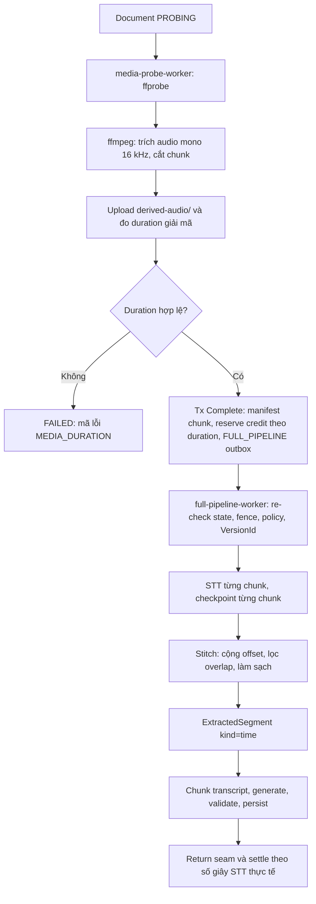

# ADR-0032: STT cho media và Citation theo thời gian

## Trạng thái

Đã chốt bởi Owner trong GitHub Issue #160 (comment quyết định ngày 2026-11-05,
D1-D10). ADR này **sửa đổi [ADR-0031](0031-media-probe-and-isolated-worker.md)
§4** (xem mục "Sửa đổi ADR-0031"). Đây là contract kiến trúc và vận hành cho
phần STT của MVP-2; tài liệu không tự xác nhận rằng code, image hoặc hạ tầng đã
được triển khai.

**Phân biệt quyết định và đề xuất.** Chỉ **D1-D10** là quyết định của Owner. Mọi
chi tiết thiết kế khác trong ADR này (độ dài chunk và overlap, bố cục key
`derived-audio/`, bitrate, cờ ffmpeg, tên biến `STT_*` ngoài `STT_BASE_URL`,
`STT_API_KEY`, `STT_MODEL`, công thức `stt_provider_identity`, preflight lúc
khởi động, tên bảng/cột và UNIQUE, định dạng khóa settle, tên mã lỗi, thuật toán
stitch, quy tắc chọn chunk, mọi con số ngưỡng) là **đề xuất của người lập thiết
kế**, được đánh dấu **[Đề xuất]**. PR thực thi được phép điều chỉnh hoặc hiệu
chỉnh chúng bằng đo đạc thật mà không cần sửa ADR, miễn là vẫn giữ D1-D10 và
các ràng buộc bảo mật.

Điều kiện chưa xác minh (chặn PR adapter STT): chưa có bằng chứng rằng endpoint
STT trên dev hỗ trợ `POST /audio/transcriptions` với `whisper-1` và
`response_format=verbose_json`. `openai-base-url` hiện trên dev là router riêng
của Owner. Xem mục "Điều kiện xác minh trước adapter STT".

## Bối cảnh

[ADR-0031](0031-media-probe-and-isolated-worker.md) (#158) đã cho phép upload
MP3 (tối đa 300 MiB) và MP4 (tối đa 500 MiB), kiểm tra bằng `ffprobe` trong
`media-probe-worker`, rồi chuyển Document sang `PROCESSING` với một job
`FULL_PIPELINE`. Việc còn thiếu (#160, thuộc epic #85) là biến lời nói trong
media thành văn bản có mốc thời gian, để tái dùng nguyên pipeline của MVP-1:
chunk, generate, validate, persist, Citation, Attempt và Grading.

Các ràng buộc làm bài toán không tầm thường:

- STT (Speech-to-Text, chuyển giọng nói thành văn bản) của provider giới hạn
  khoảng 25 MiB mỗi request (theo tài liệu API speech-to-text của OpenAI; chưa
  kiểm lại với endpoint dev, xem mục xác minh), trong khi media có thể lớn gấp hàng chục lần. Cần
  trích audio, hạ chất lượng và cắt đoạn (chunk).
- ffmpeg là parser/decoder xử lý bytes không tin cậy. ADR-0031 cấm đặt nó cùng
  Pod (đơn vị chạy container) với AI credential của full-pipeline worker.
- Full-pipeline worker hiện đọc nguồn vào RAM với trần 20 MiB, lease cố định 15
  phút, job timeout tối đa 14 phút và không có renew lease. Media dài vài giờ
  không vừa trong một lần chạy nếu STT và sinh câu hỏi chạy tuần tự.
- STT tính tiền theo phút audio, không theo token. Ước tính credit hiện tại
  (`estimatePlatformCredits` trong `content.service.ts`) dùng dung lượng file
  chia `COARSE_INPUT_TOKEN_BYTES`, nên MP4 355 giây (24.451.261 byte) bị ước
  tính 6.113.328 credit và Document `fb1ea750-38fb-4490-80e3-8e4f2eb01b43`
  thất bại `BUDGET_EXHAUSTED` trên dev, trong khi PDF được ước tính 61.906.
- Định nghĩa credit đang lệch giữa code (1 credit = 1 token) và
  `docs/10-monetization.md` (1 credit ≈ $0,001, STT ≈ 18 credit/phút).
  Thiết kế lại credit thuộc #268, không thuộc ADR này.

Thuật ngữ dùng theo [CONTEXT.md](../../CONTEXT.md): **Locator** (vị trí nguồn),
**Citation** (tham chiếu nguồn `{chunkId, locator, snippet}`), **Owner**,
**Document**. Phần Node đã chấp nhận Locator `kind=time` (`startSec`, `endSec`);
Go worker chưa sinh nó: `Locator` của Go có `MarshalJSON` riêng theo từng
`kind`, chưa có nhánh `time` và chưa có trường `startSec`/`endSec`, nên PR1 phải
thêm cả trường lẫn nhánh marshal (bảo đảm `startSec: 0` không bị bỏ do
`omitempty`). Web đã có UI hiển thị `time`
(`web/src/components/ui/citation.tsx`, `web/src/app/quiz/[id]/result/[attemptId]/page.tsx`)
nhưng mới dùng fixture/mock; PR6 nối dữ liệu thật và chỉnh cách hiển thị.

## Quyết định

### D1. STT provider: `whisper-1`, cấu hình riêng

- Dùng `whisper-1` qua `POST /audio/transcriptions` với
  `response_format=verbose_json` để nhận `segments[]` có `start`/`end`.
- Thêm port `Transcriber` riêng (không nhét vào `Generator`) với hai
  implementation: `OpenAITranscriber` (endpoint OpenAI-compatible) và
  `FakeTranscriber` cho CI/E2E offline. Capability khai báo tường minh
  (`STT_CAPABILITY_VERSION`), không suy ra từ tên model, không tự fallback
  (theo tinh thần [ADR-0004](0004-llm-provider-port-from-phase-0.md): request
  đầu có thể đã tốn tiền).
- Cấu hình **tách khỏi LLM** (Owner chốt): `STT_BASE_URL`, `STT_API_KEY`,
  `STT_MODEL`.
- **[Đề xuất]** Biến phụ `STT_PROVIDER`, `STT_CAPABILITY_VERSION`,
  `STT_REQUEST_TIMEOUT_MS`, `STT_CONCURRENCY`, `STT_MAX_CHUNK_BYTES`. Hằng số
  contract không bí mật (provider, capability) khai báo literal trong manifest,
  không đưa vào SSM.
- **[Đề xuất]** Định danh provider cho idempotency:
  `stt_provider_identity = sha256(provider_type + canonical_base_url + model +
  capability_version)`. API key không tham gia (theo ADR-0021). Công thức cố ý
  bỏ `transport` và `structured_output_mode` (có trong định danh của LLM) vì STT
  chỉ có một transport multipart và một định dạng đầu ra `verbose_json`, không có
  chế độ structured output để phân biệt; nếu sau này thêm biến thể, phải thêm
  vào công thức để không dùng nhầm checkpoint cũ.
- **[Đề xuất]** Preflight (kiểm tra sẵn sàng) khi khởi động: gửi một clip tiếng
  Việt tổng hợp ngắn và kiểm tra response có `segments[]` hợp lệ; thất bại thì
  worker không Ready.

Lựa chọn đã loại: (a) dùng chung `OPENAI_BASE_URL`: không biết router có route
audio, và proxy kiểu LiteLLM/OpenRouter có thể không hỗ trợ; (b)
`gpt-4o-transcribe`/`gpt-4o-mini-transcribe`: theo hiểu biết hiện có chỉ trả
`json`/`text`, không có segment timestamp, chưa xác minh; (c) biến thể
diarize: không cần speaker ở MVP-2; (d) self-host Whisper: cần GPU và mở rộng
hạ tầng, ngoài phạm vi (`docs/11-roadmaps.md`).

### D2. Credit cho STT: công thức tạm, ghi chi phí thật

- Ghi usage và chi phí thật cho mọi lần gọi AI: token vào/ra, số giây STT theo
  model, USD tính từ bảng giá có phiên bản.
- Ví giữ đơn vị hiện tại: 1 credit = 1 token của model mặc định
  (`gpt-5.4-mini`). STT quy đổi theo tỉ lệ giá:

  ```text
  credit STT = phút × giá STT mỗi phút ÷ giá 1 token model mặc định
  ```

- **[Đề xuất]** Ước tính cho media (hàm thuần ở Node, tính sau probe từ
  duration; công thức và tên tham số do PR2 điều chỉnh):

  ```text
  sttCredits        = ceil(durationSec × sttCreditsPerMinute / 60)
  estimatedChunks   = min(maxQuestionsPerDocument, ceil(estimatedChars / targetChars))
  generationCredits = estimatedChunks × (inputTokensPerChunk × inputRate + outputTokensPerQuestion × outputRate)
  estimatedCredits  = max(1, sttCredits + generationCredits)
  ```

  Các hằng số hiệu chỉnh (`speechCharsPerMinute`, `inputTokensPerChunk`,
  `outputTokensPerQuestion`) ban đầu chỉ là giả định và phải được hiệu chỉnh
  bằng fixture thật trước khi bật media trên dev.
- Hệ quả đã biết (Owner ghi nhận trong #268): ví Free 10.000 credit không đủ cho
  1 phút video theo tỉ lệ giá này; tài khoản test trên dev được nạp thêm
  credit. Đây là cách tạm.
  **Thiết kế lại credit theo chi phí thật: #268** (đơn vị credit, markup, quota
  gói, di trú ví). ADR này không quyết định các điểm đó.

Lựa chọn đã loại: cố định "18 credit/phút" theo `docs/10`: mâu thuẫn với đơn
vị token hiện hành và làm STT quá rẻ so với quiz (ước tính thô của người lập
thiết kế, chưa đo: cỡ vài chục lần với video vài phút), trái `docs/09` (STT là
chi phí lớn nhất).

### D3. ffmpeg chạy trong `media-probe-worker`

- Trích audio, downmix và cắt chunk chạy trong `media-probe-worker`, sau khi
  `ffprobe` đạt và trước khi `Complete`. Image probe thêm `ffmpeg` từ đúng
  artifact BtbN đã pin trong ADR-0031 §4 (cùng tarball, cùng SHA-256), kiểm
  version/checksum như `ffprobe`.
- **Full-pipeline worker không bao giờ chạy ffmpeg.** Nó chỉ đọc chunk audio đã
  chuẩn bị theo đúng `VersionId`.
- **[Đề xuất]** Lệnh ffmpeg (cờ cụ thể do PR4 chốt và kiểm trên binary đã pin):
  absolute path, không shell, stdin đóng, environment tối thiểu,
  `-protocol_whitelist file` và `-format_whitelist` trùng allowlist demuxer của
  probe, chỉ `-map 0:a:0 -vn -sn -dn -ac 1 -ar 16000`, mã hóa MP3 bitrate thấp,
  `-threads 1`; mỗi chunk một lần chạy với timeout, cap dung lượng output và
  cancel theo fence; cleanup trong `finally`.
- Cần xác minh `libmp3lame` có trong bản BtbN `gpl` đã pin (script E2E cục bộ
  đã dùng nó).
- `emptyDir`, `ephemeral-storage` và timeout của probe phải tăng tương ứng, và
  phải đo ffmpeg trên dev; các giá trị cụ thể do PR4 chốt.

Lựa chọn đã loại: (a) ffmpeg trong full-pipeline worker: decoder xử lý bytes
không tin cậy cùng Pod với AI key và DB credential, trái ADR-0031 §1; (b)
Deployment `media-audio-prep-worker` + job type mới: sạch nhất về quyền nhưng
thêm workload/ServiceAccount/NetworkPolicy, đụng queue contract ADR-0023, vượt
ngân sách CPU request của node dev (khoảng 2000m theo
`cpu-request-budget-contract.yml` trong IaC, người lập thiết kế đọc từ repo, chưa
đo lại) và trái `docs/11` "không mở rộng hạ tầng"; (c) gọi
STT bằng file gốc: vượt 25 MiB và gửi video vô ích.

Đánh đổi: probe không còn "chỉ đọc" mà có quyền `PutObject` hẹp (D4) và chạy
nặng hơn. Bù lại, probe vẫn không có AI credential, document bucket hay
`DeleteObjectVersion`; và kết quả ffmpeg đi trước bước reserve credit nên
fail-closed (không tốn tiền cho media hỏng).

### D4. Audio dẫn xuất: prefix `derived-audio/`, lifecycle khoảng 2 ngày

- Chunk lưu trong cùng media bucket, prefix `derived-audio/` (Owner chốt).
  **[Đề xuất]** Bố cục key
  `derived-audio/<ownerId>/<documentId>/<probeGeneration>/<chunkIndex>.mp3`.
  **[Đề xuất]** Manifest chunk (`VersionId`, `ETag`, `ContentLength`, `sha256`, khoảng thời
  gian thân và file) ghi vào bảng mới trong **cùng transaction** `Complete` của
  probe. Full-pipeline đọc đúng `VersionId`.
- **[Đề xuất]** Chunk: thân 600 giây, overlap (vùng chồng lấn giữa hai chunk kề
  nhau để không mất lời ở ranh giới) 5 giây mỗi phía; chunk cuối ngắn hơn `2 ×
  overlap` được gộp vào chunk trước. 32 kbps mono khoảng 2,4 MB cho 10 phút,
  nhỏ hơn nhiều giới hạn 25 MiB. Các số này cần hiệu chỉnh bằng fixture thật.
- Lifecycle (quy tắc tự hết hạn của S3) hết hạn cả current lẫn noncurrent version của prefix sau khoảng
  2 ngày (đủ cho technical retry; retry do Owner luôn re-probe nên tái tạo
  chunk).
- Mọi locator `derived-audio/` phải vào **purge manifest** khi xóa Document
  (xem mục xóa/fence) và orphan scanner coi prefix này là namespace do hệ thống
  quản lý.
- IAM do Owner cấp qua AWS Console, theo prefix: probe `s3:PutObject` trên
  `derived-audio/*` (không Delete); full-pipeline `GetObject`/`GetObjectVersion`
  trên prefix; purge xóa theo VersionId (đã có).

Lựa chọn đã loại: lưu `bytea` trong PostgreSQL (phình DB, WAL, chi phí Aiven);
ghi vào document bucket (trộn bucket, mất contract versioning).

### D5. Custom AI bị chặn cho media

Document media phải dùng Platform Model. Custom AI (BYOM, tức "mang model của
chính mình",
[ADR-0021](0021-phase-5-custom-ai-byom-openai-compatible.md)) bị chặn trong #160
vì chưa có contract STT cho endpoint của Owner, và media gửi audio ra ngoài
nền tảng. Mở lại là một quyết định riêng.

Nơi chặn: Node là cổng chính, từ chối Custom AI cho media ở estimate, cấp upload
URL và confirm. **[Đề xuất]** Go worker cũng từ chối job media có Custom AI như
phòng thủ nhiều lớp, vì hiện Go vẫn chấp nhận `CUSTOM`
(`worker/internal/contract/document_processing.go`, quanh dòng 125), nên không
được chỉ dựa vào Node.

### D6. Job dài: checkpoint từng chunk, không thêm cơ chế lease mới

- Checkpoint (điểm lưu kết quả trung gian) STT theo từng chunk trong một bảng
  mới (Owner chốt). **[Đề xuất]** Tên `ai.media_stt_chunk_results`, UNIQUE
  `(probe_result_id, chunk_index, stt_provider_identity)`.
- Retry kỹ thuật và claim lại sau khi lease hết hạn chỉ gọi STT cho chunk còn
  thiếu: không trả tiền hai lần và transcript được đóng băng nên ID chunk/câu
  hỏi ổn định (ID chunk hiện được sinh xác định từ tài liệu, owner, thứ tự và
  hash nội dung trong `processing.ChunkText`).
- Trần số câu hỏi cho media là 30 và bước generate có concurrency (Owner chốt).
  **[Đề xuất]** Chọn chunk phân bố đều theo thời gian khi vượt trần, và mức
  concurrency cụ thể, do PR5 chốt để vừa job timeout. Trần này chỉ áp cho media;
  PDF giữ hành vi hiện tại.
- **Không** thêm heartbeat/renew lease hay job type mới.

Lựa chọn đã loại: heartbeat renew lease (đổi queue contract ADR-0023); tách job
type STT riêng (thêm trạng thái, claim boundary và workload).

### D7. Sửa settlement trong #160 bằng PR riêng

Hai lỗi đã biết ở đường Go: (1) sau probe, credit đã giữ chưa được
settle/release khi job kết thúc; (2) khóa settle dùng `processingAttempt` thay
vì attempt của Go. Sửa trong PR riêng (PR3): settle dùng attempt của Go và settle/release credit đã giữ sau
probe. **[Đề xuất]** Khóa idempotency dạng `settle:{job}:{attempt}`, tính theo số
giây STT thực tế; dispatch đã xảy ra nhưng không biết kết quả thì phần chưa xác
định giữ ở `HELD` (theo ADR-0022); thất bại trước mọi dispatch STT thì release
toàn bộ. PR3 có thể chỉnh định dạng khóa miễn giữ được tính idempotent. **Không bật media trên dev tới khi
PR3 merge và kiểm chứng.**

### D8. Ước tính trước upload: `AFTER_MEDIA_CHECK`

Trước upload, media chưa có duration đáng tin. API trả
`precision: 'AFTER_MEDIA_CHECK'` và `estimatedCredits: null` kèm mô tả "credit
được tính sau khi kiểm tra file", thay vì số theo dung lượng. Reserve vẫn chỉ
diễn ra ở probe completion (ADR-0031), dùng duration đã đo.

Lựa chọn đã loại: cận trên theo trần 7.200 giây (chặn nhầm ví nhỏ); giữ công
thức theo bytes (nguyên nhân gốc lỗi `BUDGET_EXHAUSTED`).

### D9. Migration: ba migration expand-only

Owner chốt: tối đa 3 migration chỉ thêm (expand-only), không đổi/xóa cột cũ,
không sửa migration đã áp dụng. **[Đề xuất]** Nội dung và tên cụ thể:

1. `ai.media_audio_chunks` (manifest chunk; GRANT INSERT cho role probe, SELECT
   cho role full-pipeline).
2. `ai.media_probe_results ADD COLUMN decoded_duration_ms integer NULL`.
3. `ai.media_stt_chunk_results` (checkpoint, D6).

Probe/worker cũ phải chạy được khi rollout: cột nullable; full-pipeline mới coi
`media_audio_chunks` rỗng là "chưa chuẩn bị" và trả lỗi nghiệp vụ có kiểm soát,
không crash. Khi xóa Document, dọn transcript và audio dẫn xuất của các bảng
mới; **`ai.chunks` để #214**.

### D10. Duration tính tiền là duration giải mã thật

Credit tính theo duration của audio đã giải mã, không theo metadata container.
Từ chối khi lệch metadata quá `max(5 giây, 2%)` với lỗi nghiệp vụ không retry
(Owner chốt). **[Đề xuất]** Tên mã lỗi `MEDIA_DURATION_MISMATCH`; làm tròn
`ceil(decoded)`; `decoded > 7.200 giây` là `MEDIA_DURATION_EXCEEDED`. Nhờ đó metadata giả không hạ giá hay phình giá.

## Sửa đổi ADR-0031

ADR-0031 §4 hiện nêu image probe chỉ chứa `ffprobe` và "không mang executable
full-pipeline không cần thiết". ADR này sửa như sau:

- Image `media-probe-worker` chứa **cả `ffprobe` và `ffmpeg`** từ cùng artifact
  đã pin; mọi điều kiện sandbox của §4 (không shell, stdin đóng, env tối thiểu,
  protocol local-only, timeout, cap output, `emptyDir` có `sizeLimit`, non-root,
  read-only root filesystem, seccomp, drop capabilities) áp dụng nguyên cho
  ffmpeg.
- Probe được thêm quyền `PutObject` vào prefix `derived-audio/` (D4). Các quyền
  bị cấm ở §1 (AI provider, document bucket, playback credential,
  `DeleteObjectVersion`, `FULL_PIPELINE`) giữ nguyên.
- Full-pipeline worker không chạy ffmpeg và không đọc "latest" của prefix này.
- Các phần khác của ADR-0031 (queue, claim, locator, xóa, egress) giữ nguyên.

## Luồng dữ liệu



Return seam là đường trả kết quả từ Go worker về Node đã có (ADR-0023). Stitch
(ghép transcript các chunk thành một dòng thời gian liên tục) dưới đây là
**[Đề xuất]**: hàm thuần trong Go; mỗi segment cộng `fileStartSec` thành thời gian
tuyệt đối; segment được giữ khi trung điểm nằm trong thân chunk của nó (chunk kề
nhận phần còn lại, không so khớp chuỗi mờ); lọc segment rỗng và segment nghi
hallucinate theo `no_speech_prob`/`avg_logprob` (ngưỡng hiệu chỉnh bằng fixture);
kẹp `[0, D]`, ép `end >= start` và không giảm dần, làm tròn 3 chữ số. Transcript
quá ngắn là lỗi nghiệp vụ `MEDIA_TRANSCRIPT_EMPTY` (không retry). Chunk văn bản
gói nguyên segment, `chunk.Locator = {time, startSec: đầu, endSec: cuối}`; từ
đó Locator đi thẳng sang Citation như `page` hiện nay.

## Ranh giới bảo mật

| Thành phần | Danh tính/credential | Được | Bị cấm |
| --- | --- | --- | --- |
| `media-probe-worker` | DB role và S3 credential riêng của probe | Đọc exact VersionId media; ffprobe/ffmpeg; `PutObject` `derived-audio/*`; ghi manifest trong tx `Complete` | AI/STT credential, document bucket, Delete, claim `FULL_PIPELINE` |
| `full-pipeline-worker` | DB role và `OBJECT_STORAGE_FULL_PIPELINE_MEDIA_*` riêng | Đọc exact VersionId chunk; gọi STT/LLM; ghi checkpoint và kết quả | Chạy ffmpeg/ffprobe, claim `MEDIA_PROBE`, đọc latest, bỏ qua fence |
| purge worker | Credential purge riêng | Hard-delete theo `bucket + key + VersionId` trong manifest | Xóa ngoài manifest |

- `STT_*` là cấu hình và secret riêng; `STT_API_KEY` chỉ nằm ở full-pipeline
  worker (qua SSM/ExternalSecret do Owner tạo, không bake vào image, không log,
  không in).
- **Egress allowlist cho endpoint STT**: gọi STT là egress ra ngoài, khác đường
  S3 (đi qua `media-egress-proxy`). Hiện Pod `worker` chưa có NetworkPolicy
  riêng. Ghi nhận là rủi ro còn lại: nếu STT cùng host với `OPENAI_BASE_URL`
  thì bề mặt không đổi; nếu Owner muốn khóa, phải thêm allowlist cho đúng host
  `STT_BASE_URL` (Node relay chung Pod nên cần kiểm kỹ). PR7 phải nêu rõ quyết
  định này và bằng chứng; không mở egress rộng.
- Custom AI bị chặn cho media (D5).
- Không log transcript, nội dung audio, key hay response thô; lỗi dùng mã an
  toàn.

## Lỗi, retry, idempotency, xóa và fence

Các nguyên tắc dưới đây (retry kỹ thuật, không trả tiền hai lần, deletion fence
thắng, không commit kết quả cũ) bám D6, D7, D9 và ADR-0031. Tên mã lỗi, tên khóa
và chi tiết giao dịch là **[Đề xuất]**, PR thực thi được điều chỉnh.

- Lỗi STT: 429/5xx/timeout là `PROVIDER_UNAVAILABLE` (technical, retry theo
  backoff hiện có); 4xx cố định (`400/413/415`) là `PROVIDER_INCOMPATIBLE`;
  envelope sai là `TRANSCRIPTION_OUTPUT_INVALID`. Mã nghiệp vụ mới phải đồng bộ
  Go/Node/Web (`MEDIA_DURATION_EXCEEDED`, `MEDIA_DURATION_MISMATCH`,
  `MEDIA_TRANSCRIPT_EMPTY`, và mã cho trường hợp audio chưa được chuẩn bị).
- Checkpoint ghi từng chunk ngay khi provider trả về, trong transaction nhỏ có
  `lockActiveJob` (attempt, lease, status, chưa cancel); mất fence thì bỏ kết quả,
  không commit stale. `PersistAndComplete` vẫn là một transaction và xóa
  checkpoint của job; giữ checkpoint khi retry được lên lịch.
- Duplicate delivery: claim + `lockActiveJob` + unique chunk + outbox một lần;
  reserve `reserve:{job}:{processingAttempt}`, settle `settle:{job}:{attempt}`.
- Kiểm tra context trước mỗi request STT trả tiền; SIGTERM làm job hết lease rồi
  claim lại và tiếp tục từ checkpoint, không commit kết quả dở.
- Xóa Document: transaction xóa (đã có advisory lock và manifest ở ADR-0031 §3)
  gộp locator `derived-audio/` vào purge manifest và xóa checkpoint/chunk
  manifest của bảng mới; deletion fence thắng cả probe/ffmpeg, STT và settle.
  Lifecycle 2 ngày chỉ là lớp bảo hiểm, không thay purge manifest.

## Giải thích thuật ngữ

- **Lease** (quyền xử lý job có thời hạn); **fence** (cờ chặn: worker mất quyền
  hoặc Document đã bị xóa thì không được ghi kết quả); **deletion fence** là
  fence do việc xóa Document tạo ra.
- **Idempotency** (chạy lặp vẫn cho cùng một kết quả, không tạo bản trùng);
  **checkpoint** (điểm lưu kết quả trung gian để chạy lại không làm lại từ đầu).
- **Manifest** (danh sách bất biến các object cần quản lý); **purge** (xóa hẳn
  object khỏi storage theo manifest); **lifecycle** (quy tắc tự hết hạn của S3).
- **Outbox** (bản ghi việc cần giao, ghi cùng transaction để không mất);
  **egress** (đường đi ra mạng ngoài); **allowlist** (danh sách được phép).
- **Preflight** (kiểm tra sẵn sàng trước khi chạy thật); **VersionId** (mã phiên
  bản của object trên S3 có bật versioning); **emptyDir** (thư mục tạm của Pod,
  mất khi Pod bị xóa); **ServiceAccount** (danh tính workload trên Kubernetes).
- **Overlap** (vùng chồng lấn giữa hai chunk); **stitch** (ghép kết quả các
  chunk); **diarize** (nhận diện từng người nói); **BYOM** (người dùng tự mang
  model của mình).

## Chia PR

| PR | Nội dung |
| --- | --- |
| PR0 | ADR-0032 (tài liệu này) và xác minh STT endpoint thật |
| PR1 | Go: Locator time, chunker transcript, stitch, `FakeTranscriber`, fixture tiếng Việt |
| PR2 | Node: estimate/reserve theo duration, bảng giá, `AFTER_MEDIA_CHECK` |
| PR3 | Settlement (D7) |
| PR4 | Audio prep trong probe (ffmpeg, `derived-audio/`, manifest, purge) |
| PR5 | STT ở full pipeline (checkpoint, usage) |
| PR6 | Web: hiển thị Citation thời gian |
| PR7 | Secret/IaC, E2E tới Grade, bằng chứng dev |

Mỗi PR đi qua AI review, worker sửa, AI review lại, rồi mới tới Owner.

## Điều kiện xác minh trước adapter STT

Trước khi viết `OpenAITranscriber`, phải gọi **một lần thật** tới endpoint STT
của dev và ghi kết quả vào #160:

```text
POST {STT_BASE_URL}/audio/transcriptions
  model=whisper-1, response_format=verbose_json,
  timestamp_granularities[]=segment, file=<mẫu ngắn>
```

Phải xác nhận: route tồn tại; response có `segments[]` với `start`/`end`;
phản hồi lỗi cho file quá cỡ. Trạng thái hiện tại: **chưa xác minh**. Nếu
endpoint không có route audio, cần một endpoint STT riêng và D1 phải cập nhật.
Việc này tốn chi phí nhỏ và dùng credential của Owner; không in secret.

## Hệ quả và đánh đổi

- Không thêm workload, queue hay job type; đổi lại probe nặng hơn và có thêm
  quyền ghi hẹp.
- Credit tạm làm STT và quiz dùng cùng đơn vị token; ví Free hiện không đủ cho
  media. Sai lệch này được chấp nhận có điều kiện tới khi #268 xong.
- Thêm vùng rủi ro cao ở purge/xóa (audio dẫn xuất, transcript); cần review
  riêng ở PR4 và PR5.
- Timestamp Whisper chỉ xấp xỉ (sai số vài giây); UI hiển thị khoảng thời gian,
  không hứa độ chính xác tuyệt đối.

## Các lựa chọn đã loại

Xem từng mục D1-D10. Tóm tắt: ffmpeg trong full-pipeline worker, workload prep
riêng, lưu audio trong PostgreSQL hoặc document bucket, heartbeat lease, job
type STT riêng, ước tính theo bytes hoặc cận trên 7.200 giây, dùng chung cấu
hình LLM cho STT.

## Kiểm chứng bắt buộc trước khi gọi hoàn thành #160

1. Xác minh endpoint STT thật như mục trên.
2. Test Jest/Go với fake provider; E2E offline Document, probe, STT, Quiz,
   Attempt, Grade.
3. Ước tính media vài phút không `BUDGET_EXHAUSTED` vì dung lượng file.
4. Replay/duplicate/cancel không tạo Quiz, Question hay settlement trùng; xóa
   Document chặn STT và dọn `derived-audio/`.
5. Rendered manifest chứng minh probe không có AI/STT credential và
   full-pipeline không có ffmpeg.
6. Kiểm runtime trên dev sau deploy, kèm bằng chứng.

Quyết định nền được kế thừa:
[ADR-0004](0004-llm-provider-port-from-phase-0.md),
[ADR-0021](0021-phase-5-custom-ai-byom-openai-compatible.md),
[ADR-0022](0022-credit-preflight-processing-retry-and-quiz-state.md),
[ADR-0023](0023-postgresql-durable-work-queue-contract.md) và
[ADR-0031](0031-media-probe-and-isolated-worker.md). Thiết kế lại credit:
#268.
